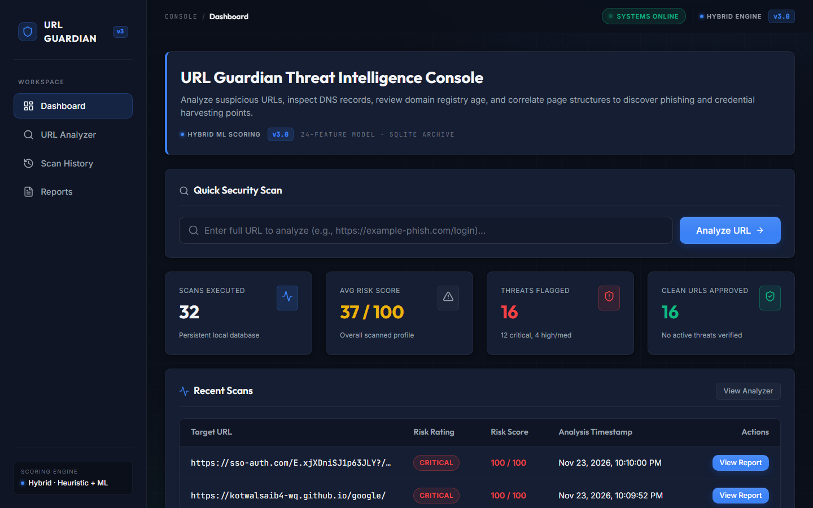
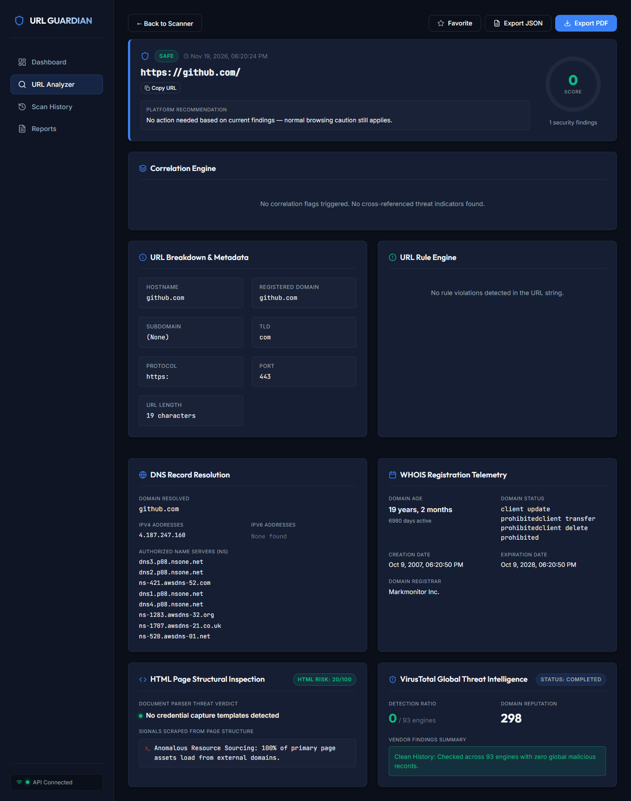
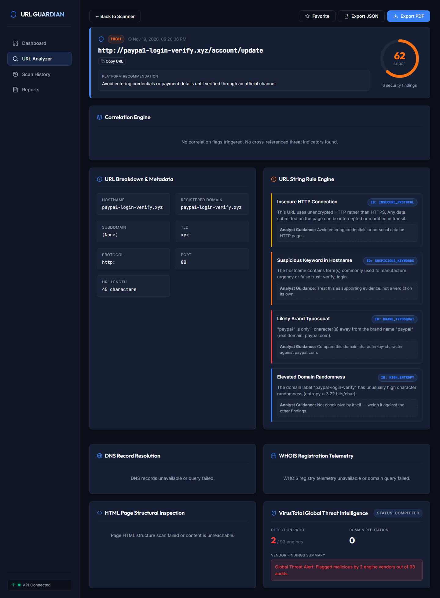

# URL Guardian — URL Analysis Engine v3


A phishing and malicious-URL detection system built as a Final Year Project. It analyzes a URL through several independent intelligence layers, correlates the signals across them, and produces an explainable risk score. Every scan is persisted to a local SQLite database and browsable from the dashboard.

## Features

- **Lexical URL analysis**: a custom rule engine that checks for brand impersonation and typosquatting (Levenshtein distance), homograph and punycode attacks, suspicious keywords, high-entropy strings, IP-based hosts, URL shorteners, risky file extensions, non-standard ports, subdomain abuse and redirect patterns.
- **DNS lookup**: resolves IPv4/IPv6 addresses and name servers.
- **WHOIS lookup**: domain age, registrar and expiry, so newly registered domains can be flagged.
- **HTML content analysis**: fetches the page through ScrapingBee and inspects it for phishing indicators (forms, credential fields, obfuscation and so on).
- **VirusTotal reputation**: aggregated verdicts from VirusTotal's scanning engines.
- **Correlation engine**: combines signals from different sources, for example *new domain + brand keyword + login form*.
- **Unified feature pipeline**: every layer's output (DNS / WHOIS / HTML / VirusTotal / lexical) plus the correlations is reduced to one flat list of scored features. A single code path then mitigates, aggregates and caps the score — and the same pass emits a fixed-schema numeric feature vector for the ML/dataset work. HTML structural signals now feed the score instead of being display-only.
- **Explainable risk scoring**: a 0–100 score, a risk level, the contribution of each signal and a plain-language justification.
- **Persistent scan history**: every analysis is stored in SQLite (via Node's built-in `node:sqlite`) and served from a versioned `/api/v1/scans` API — no longer limited to a single browser's `localStorage`.
- **Evaluation harness**: a labeled corpus (benign vs. phishing) is run through the real pipeline to report accuracy, precision, recall, F1 and ROC-AUC, and to export the feature dataset for the ML scoring step.
- **ML scoring**: a from-scratch, L2-regularised logistic-regression model is trained on the feature dataset and blended with the heuristic score (`hybrid`) in the live pipeline, with out-of-fold cross-validation to report honest metrics.
- **Dashboard UI**: an analyzer, scan history, reports and export.

## Screenshots

**Dashboard (v3 console UI)** — live scan statistics, threat banner and recent-scan history:



| Analyzer — safe result | Analyzer — phishing result |
| --- | --- |
|  |  |

## Sample analysis reports

Two real, live phishing URLs analysed end-to-end (WHOIS + DNS + HTML + VirusTotal + lexical + correlation). Both are correctly flagged **CRITICAL (100)**.

### 1. Google credential-phishing clone
`https://kotwalsaib4-wq.github.io/google/`

| Layer | Result |
| --- | --- |
| Verdict | **CRITICAL — 100 / 100** |
| WHOIS | MarkMonitor · registered 2013 (5008 days old) |
| DNS | `185.199.108–111.153` (GitHub Pages) |
| VirusTotal | 11 / 91 engines flagged |
| HTML | risk 100 — brand mismatch `[GOOGLE]`, keylogger hooks, JS redirect, 100% external assets |
| Correlation | `CORR_BRAND_IMPERSONATION` |

### 2. Facebook credential-harvesting clone
`https://sso-auth.com/…/facebook_secure_account?…`

| Layer | Result |
| --- | --- |
| Verdict | **CRITICAL — 100 / 100** |
| WHOIS | Gandi SAS · registered 2025 (601 days) |
| DNS | `212.104.128.0–3` |
| VirusTotal | not yet indexed (0/0, scan queued) |
| HTML | risk 100 — password field, brand mismatch `[FACEBOOK]`, isolated form, JS redirect |
| Correlation | `CORR_CREDENTIAL_HARVESTING`, `CORR_BRAND_IMPERSONATION` |

> The full JSON for both scans is in [`docs/reports/`](docs/reports/).

## Architecture

```
client/  (React 19 + Vite)
   │  POST /api/v1/analyze { url }
   ▼
server/  (Node.js 22.5+ + Express 5)
   ├─ validate middleware (http/https only)
   └─ analysis.service ── runs in parallel ──┬─ dns.service
                                             ├─ whois.service       (whoisjson.com)
                                             ├─ htmlFetcher/Analyzer (ScrapingBee + cheerio)
                                             ├─ virusTotal.service  (VirusTotal v3)
                                             └─ urlLexical.service  (url-lexical-engine)
                         ▼
             correlation.service → featureExtractor → risk.service → ml/scoring → explanation.service
                         ▼
             scanRepository → SQLite (server/data/guardian.db)
                         ▲
             GET/PATCH/DELETE /api/v1/scans  (dashboard history)
```

### Risk levels

| Score  | Level    |
| ------ | -------- |
| 0      | SAFE     |
| 1–20   | LOW      |
| 21–40  | MEDIUM   |
| 41–70  | HIGH     |
| 71–100 | CRITICAL |

## Getting started

### Prerequisites

- Node.js **22.5+** (uses the built-in `node:sqlite` module — no native build step)
- API keys (free tiers work):
  - [VirusTotal](https://www.virustotal.com/gui/my-apikey)
  - [WhoisJSON](https://whoisjson.com)
  - [ScrapingBee](https://www.scrapingbee.com)

### 1. Backend

```bash
cd server
npm install
cp .env.example .env      # then add your API keys to .env
npm run dev               # http://localhost:5000
```

### 2. Frontend

```bash
cd client
npm install
npm run dev               # http://localhost:5173
```

The frontend reads the backend URL from `VITE_API_URL` (see `client/.env.example`). In development it defaults to `http://localhost:5000`. In a production build it defaults to the same origin as the frontend.

### Configuration (`server/.env`)

| Variable                    | Default                 | Description                                                        |
| --------------------------- | ----------------------- | ------------------------------------------------------------------ |
| `PORT`                      | `5000`                  | API port                                                           |
| `VIRUSTOTAL_API_KEY`        | —                       | VirusTotal v3 API key                                              |
| `WHOIS_API_KEY`             | —                       | WhoisJSON API key                                                  |
| `SCRAPINGBEE_API_KEY`       | —                       | ScrapingBee API key                                                |
| `CORS_ORIGIN`               | `http://localhost:5173` | Comma-separated list of allowed frontend origins                   |
| `RATE_LIMIT_WINDOW_MINUTES` | `15`                    | Rate-limit window for `POST /api/analyze`                          |
| `RATE_LIMIT_MAX`            | `20`                    | Maximum scans per IP in each window                                |
| `LOG_LEVEL`                 | `info`                  | `error`, `warn`, `info` or `debug` (`debug` logs scanned URLs)     |
| `DATABASE_PATH`             | `server/data/guardian.db` | SQLite database file location                                   |
| `SCORING_MODE`              | `hybrid`                | `heuristic`, `ml` or `hybrid` — how the final score is produced    |
| `ML_WEIGHT`                 | `0.5`                   | Weight of the ML probability in `hybrid` mode (0–1)                |

## Security

- **Input validation:** only `http:` and `https:` URLs up to 2048 characters are accepted, parsed with the WHATWG `URL` API.
- **Rate limiting:** scans are limited per IP to protect third-party API quotas.
- **CORS:** only the origins listed in `CORS_ORIGIN` are allowed.
- **Security headers:** set with [helmet](https://helmetjs.github.io/).
- **Request size:** JSON bodies are limited to 10 KB.
- **Errors:** responses are always JSON and never expose stack traces.
- **Secrets:** API keys live only in `server/.env`, which is gitignored.

## API

All endpoints are versioned under `/api/v1`.

### `GET /api/v1/analyze`

Health check.

```json
{ "status": "ok", "message": "URL Guardian API v1 is running." }
```

### `POST /api/v1/analyze`

```json
{ "url": "https://example.com" }
```

Analyzes the URL and persists the result. The response is the analysis result, with `id`, `isFavorite` and `timestamp` attached for the stored record.

Errors return `{ "success": false, "message": "..." }` with status `400` (invalid input), `413` (body too large), `429` (rate limited) or `500`.

Response (abridged):

```json
{
  "id": "0f0c...",
  "url": "https://example.com/",
  "findings": { "dns": {}, "whois": {}, "html": {}, "virustotal": {}, "lexical": {} },
  "correlations": [],
  "score": 0,
  "risk": "SAFE",
  "isFavorite": false,
  "timestamp": "2026-01-01T00:00:00.000Z",
  "features": [
    { "source": "whois", "id": "WHOIS_NEW_REGISTRATION", "severity": "HIGH", "weight": 25, "contribution": 25 }
  ],
  "featureVector": { "domain_age_days": 12, "vt_positive_ratio": 0, "has_typosquat": 0, "html_risk_score": 0 },
  "explanation": {}
}
```

`features` is the unified, scored signal list (each entry carries its `weight` and post-mitigation `contribution`). `featureVector` is the fixed-schema numeric vector used by the dataset / ML evaluation.

### Scan history

| Method   | Path                              | Description                          |
| -------- | --------------------------------- | ------------------------------------ |
| `GET`    | `/api/v1/scans`                   | List all stored scans, newest first  |
| `GET`    | `/api/v1/scans/:id`               | Fetch a single stored scan           |
| `PATCH`  | `/api/v1/scans/:id/favorite`      | Toggle a scan's favorite flag        |
| `DELETE` | `/api/v1/scans/:id`               | Delete a single scan                 |
| `DELETE` | `/api/v1/scans`                   | Clear the entire scan history        |

Each scan record includes a `result` field with the full stored analysis payload.

## Evaluation

`npm run evaluate` builds the labeled corpus (`server/src/dataset/scenarios.js`), runs each
sample through the real pipeline (the lexical engine analyses each URL; WHOIS/VT/DNS come
from the recorded scenario values), then scores the predictions.

Metrics reported: **accuracy, precision, recall, F1, ROC-AUC**, a confusion matrix and a
per-sample pass/fail table. The materialised feature vectors + labels are written to
`server/data/featureDataset.json` for the ML training step (#4).

```bash
cd server
npm run evaluate
```

Current run (threshold: score ≥ 20 ⇒ phishing):

| Metric    | Value   |
| --------- | ------- |
| Accuracy  | 92.9%   |
| Precision | 93.3%   |
| Recall    | 93.3%   |
| F1        | 93.3%   |
| ROC-AUC   | 0.9821  |

The two misclassifications are intentional hard cases that document the current limits:
`bit.ly/…` (shortener not expanded → false negative) and `bbc.com` (a real typosquat false
positive against the `abc` brand) — both are targets for the ML step and URL expansion.

Environment knobs: `EVAL_THRESHOLD`, `EVAL_STRICT=1`, `EVAL_MIN_PRECISION`, `EVAL_MIN_RECALL`.

## Machine learning

The heuristic score is a hand-tuned set of weights. The ML layer learns those weights from
data instead:

1. **Train** — `npm run train` fits an L2-regularised logistic-regression model (implemented
   from scratch in `src/ml/logisticRegression.js`, no dependencies) on the 24-feature vectors
   exported by the evaluation step, and writes `data/model.json`. A pre-trained model is
   included, so hybrid scoring works out of the box (retrain after changing the corpus).
2. **Evaluate** — `npm run evaluate:ml` compares the heuristic, the ML model and their hybrid
   on the corpus using **stratified 5-fold cross-validation**. ML and hybrid scores are
   out-of-fold (each from a model that never saw that sample), so the numbers are an honest
   generalisation estimate rather than training accuracy.

Current results (28 samples):

| Model     | Accuracy | Precision | Recall | F1    | ROC-AUC |
| --------- | -------- | --------- | ------ | ----- | ------- |
| Heuristic | 92.9%    | 93.3%     | 93.3%  | 93.3% | 0.9821  |
| ML        | 92.9%    | 100.0%    | 86.7%  | 92.9% | 0.9026  |
| Hybrid    | 92.9%    | 93.3%     | 93.3%  | 93.3% | 0.9821  |

Read honestly: on a 28-sample corpus the ML classifier reaches **100% precision** (zero false
alarms) but lower recall, while the hand-tuned heuristic has balanced precision/recall. The
**hybrid** is a conservative, fail-safe ensemble — it never lets the ML downgrade a
HIGH/CRITICAL heuristic verdict — so it matches the heuristic while staying robust to a
mis-firing model. With a larger labeled corpus the ML is expected to overtake the heuristic;
the pipeline is built to scale (drop scenarios into `src/dataset/scenarios.js`, then re-run
`npm run evaluate` and `npm run train`).

The live pipeline uses the hybrid by default (`SCORING_MODE=hybrid`); set `SCORING_MODE=heuristic`
or `SCORING_MODE=ml` to switch, and `ML_WEIGHT` to tune the blend. When no trained model is
present it degrades gracefully to the heuristic.

> Caveat: the corpus is small (28 samples), so these figures are indicative. The pipeline is
> built to scale — drop a larger labeled set into `src/dataset/scenarios.js`, re-run
> `npm run evaluate` and `npm run train`.

## Scripts

| Location | Command            | Description                                   |
| -------- | ------------------ | --------------------------------------------- |
| server   | `npm run dev`      | Start the API with auto-reload                |
| server   | `npm start`        | Start the API                                 |
| server   | `npm test`         | Run unit tests (`node:test`)                  |
| server   | `npm run validate` | Run the engine accuracy suite on mock scenarios (reports classification and exact-level accuracy) |
| server   | `npm run evaluate` | Run the labeled evaluation harness (precision/recall/F1/AUC + feature dataset export) |
| server   | `npm run train`    | Train the logistic-regression model → `data/model.json` |
| server   | `npm run evaluate:ml` | Cross-validated ML vs heuristic vs hybrid comparison |
| client   | `npm run dev`      | Start the Vite dev server                     |
| client   | `npm run build`    | Production build to `client/dist`             |
| client   | `npm run lint`     | Lint with oxlint                              |

## Project structure

```
├── docs/                    # screenshots + sample analysis reports (docs/reports/)
├── client/
│   └── src/
│       ├── api/            # backend API client
│       ├── components/     # analysis panels, gauges, navigation
│       ├── hooks/          # scan history
│       ├── pages/          # Analyzer, Dashboard, History, Reports
│       └── utils/          # formatters, export helpers
└── server/
    ├── src/
    │   ├── controllers/
    │   ├── dataset/        # labeled scenarios + HTML signal patterns
    │   ├── db/             # SQLite connection + scan repository (node:sqlite)
    │   ├── evaluation/     # metrics, dataset builder, evaluation harness
    │   ├── middleware/     # logger, URL validation, rate limiting, error handling
    │   ├── routes/         # analyze + scan history routes (/api/v1)
    │   ├── scripts/        # engine validation + evaluation CLIs
    │   ├── services/       # intelligence layers, correlation, risk, explanation
    │   │   ├── features/   # unified feature extractor + scoring weights
    │   │   └── backend-integration/url-lexical-engine/
    │   ├── ml/           # logistic regression, cross-validation, model persistence, scoring
    │   └── utils/          # leveled logger
    ├── data/               # SQLite database + exported feature dataset (gitignored)
    └── test/               # node:test suites (metrics, dataset, features, repository)
```

## Acknowledgements

- Public suffix data comes from the [Mozilla Public Suffix List](https://publicsuffix.org/) (MPL-2.0).

## Disclaimer

This tool is for educational and research purposes. Its risk scores are heuristic and can produce false positives or negatives. Don't rely on it as your only security control.

## License

[MIT](LICENSE)
